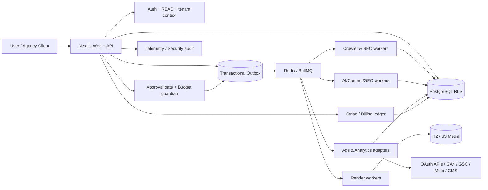

# GROWTHOS AI — Arquitectura técnica, datos, API y seguridad
**Referente de implementación:** Claude Code | **versión:** 1.0

## 1. Principios de arquitectura
- **SaaS multi-tenant desde la primera migración**, tenant_id en todo dato del cliente, políticas RLS y tests de aislamiento.
- **Modular monolith** para negocio al inicio, **workers separados** para crawling/IA/render/sync; contratos bien delimitados y salida posterior a servicios si el tráfico lo exige. Evitar microservicios por moda.
- **Proveedor intercambiable** para modelos IA, datos SEO, TTS, imagen, vídeo y CRM/ad networks. Implementar primero mock y uno real por dominio; no simular integraciones no aprobadas.
- **Orquestación durable** para trabajos lentos; idempotencia obligatoria; jobs con estados, logs, retries exponenciales y dead-letter.
- **Human-in-the-loop** para cualquier acción pública con efectos económicos o reputacionales.
- **Observabilidad y economía unitaria**: traza por tarea e IA request, coste real aproximado, facturación conciliable.

## 2. Stack sugerido, sujeto a validación de versiones en el momento de iniciar repo
| Capa | Elección recomendada | Razón |
|---|---|---|
| Monorepo | pnpm workspaces + Turborepo | UI/web/workers/packages cohesivos |
| Web | Next.js App Router + React + TypeScript strict | SSR, API, SaaS dashboard |
| UI | Tailwind + shadcn/ui + Radix + Lucide | accesible, tokens, design system propio |
| Auth | Supabase Auth (alternativa Auth.js con proveedor verificado) | OAuth, sesiones y MFA según soporte |
| DB | PostgreSQL con Drizzle ORM + SQL migrations + RLS | tipado, relacional, multi-tenant |
| Hosting | frontend Vercel/Cloudflare o runtime Node compatible; Postgres gestionado | validar workers y límites de runtime por proveedor |
| Queue | Redis + BullMQ en worker Node persistente | trabajos de IA/crawl/render no bloqueantes |
| File storage | Cloudflare R2 o S3 + URLs presignadas | imágenes, vídeo, exports, render outputs |
| Data | GA4 Data API + Search Console API + proveedores SERP/keywords con licencia | evidencia real |
| SEO | Playwright browser pool + HTML parser + Lighthouse/PageSpeed APIs | técnico con crawl seguro |
| IA | gateway de modelos configurable con Zod schemas y logging de costes | fallback y control de datos |
| Creatives | motor SVG/canvas en editor + image provider autorizado | exportación y versiones |
| Video | Remotion + FFmpeg en worker aislado | renders deterministas y audio/QA |
| Adapters | Meta Marketing API primero; Google/TikTok/LinkedIn después | scopes y app review |
| Billing | Stripe Checkout, Portal, Billing webhooks | suscripciones, add-ons y créditos |
| Email/WhatsApp | Resend + WhatsApp Business Cloud API autorizada | notificaciones y workflow |
| Observability | Sentry, OpenTelemetry, logs estructurados, dashboard de jobs | incident response |
| Tests | Vitest, Playwright, MSW, contract tests, axe | calidad |

## 3. Estructura de repositorio
```text
growthos/
  apps/
    web/                       # Next.js pages, dashboard, API route handlers
    worker/                    # BullMQ workers and integrations
    render/                    # Remotion isolated video renderer
  packages/
    ui/                        # tokens/components/stories
    database/                  # Drizzle schema/migrations/RLS policies
    auth/                      # policies/RBAC/roles
    contracts/                 # Zod schemas, OpenAPI types
    ai/                        # model router, prompt registry, evals
    crawler/                   # SSRF-safe fetch, robots, sitemaps
    seo/                       # audit/rules/score
    geo/                       # prompt monitor/evidence
    content/                   # drafting, editorial pipeline
    creative/                  # brand kit/assets/templates
    media/                     # TTS, subtitles, Remotion specs
    ads/                       # channel adapter interface
    analytics/                 # canonical events/attribution
    billing/                   # immutable ledger/limits
    automation/                # workflow/action approvals
    security/                  # input policy, content trust, audit
  infra/                       # docker compose, IaC, dashboards
  docs/                        # ADR, runbooks, PRD, OpenAPI, privacy
  .github/workflows/           # CI/security/release
  CLAUDE.md
  package.json
  pnpm-workspace.yaml
```

## 4. Arquitectura de ejecución


### Jobs / estados
`queued -> validating -> running -> awaiting_approval -> completed | failed | cancelled`; acciones aprobadas `draft -> preview -> approved -> publishing -> published | failed | rolled_back`. Mantener `attempts`, `job_key`, `provider_job_id`, `last_error`, `retry_after`, `actor`, `created_at`, `finished_at`.

### Integridad de eventos
Patrón outbox dentro de transacción DB: registrar estado negocio + `outbox_events` → worker lee/publica idempotente; idempotency keys por comando. Cada webhook externo verifica firma, marca `provider_event_id UNIQUE`, persiste payload mínimos cifrados si procede, devuelve 2xx solo tras encolar/persistir.

## 5. Modelo relacional mínimo para F0–F3
**Tablas core (PK UUID, timestamps, soft-delete solo cuando corresponde):**
- `users(id, email, email_verified_at, locale, timezone)`
- `organizations(id, name, slug, billing_customer_id, currency, region, created_at)`
- `memberships(id, organization_id, user_id, role, status, invited_by)`
- `brands(id, organization_id, name, domain, vertical, description, default_locale, default_currency)`
- `brand_profiles(id, organization_id, brand_id, facts_json, audience_json, tone_json, prohibited_claims_json, confirmed_at, confirmed_by)`
- `sites(id, organization_id, brand_id, url, verification_status, verification_method, verified_at, crawl_policy_json)`
- `integrations(id, organization_id, brand_id, provider, status, scopes_json, secret_ref, account_ref, last_sync_at)`
- `jobs(id, organization_id, brand_id, kind, state, idempotency_key, input_json, output_ref, cost_estimate, cost_actual, failure_code)`
- `job_events(id, organization_id, job_id, level, kind, data_redacted_json, created_at)`
- `audit_logs(id, organization_id, actor_user_id, action, entity_type, entity_id, before_redacted, after_redacted, ip_hash, approved_by, created_at)`
- `web_crawls(id, organization_id, site_id, status, pages_count, started_at, completed_at, robots_snapshot_ref)`
- `crawl_pages(id, organization_id, crawl_id, url, status_code, canonical, title, description, h1, content_hash, metadata_json)`
- `seo_issues(id, organization_id, crawl_id, page_id, rule_key, severity, evidence_json, fix_guidance, status)`
- `keywords(id, organization_id, brand_id, phrase, locale, region, intent, source, volume, difficulty, observed_at)`
- `content_topics(id, organization_id, brand_id, keyword_id, cluster_key, funnel_stage, priority, scheduled_at)`
- `content_items(id, organization_id, brand_id, topic_id, type, title, slug, status, language, current_version_id)`
- `content_versions(id, organization_id, content_item_id, version, body_md, metadata_json, citations_json, quality_json, created_by)`
- `publication_targets(id, organization_id, brand_id, integration_id, platform, target_path, settings_json)`
- `publications(id, organization_id, content_version_id, target_id, remote_id, remote_url, status, published_at, error_json)`
- `tracked_prompts(id, organization_id, brand_id, question, engine, locale, region, intent, enabled)`
- `ai_response_samples(id, organization_id, prompt_id, engine, model_info, observed_at, mentioned_brands_json, cited_urls_json, raw_response_ref, restrictions_json)`
- `assets(id, organization_id, brand_id, media_type, storage_key, version, license_status, rights_json, checksum, metadata_json)`
- `approvals(id, organization_id, object_type, object_id, requested_by, approved_by, state, reason, expires_at)`
- `plans(id, code, limits_json, price_id, active)`
- `subscriptions(id, organization_id, plan_id, provider_sub_id, status, current_period_end)`
- `credit_ledger(id, organization_id, job_id, category, amount, currency_or_unit, entry_kind, provider, source_event_id UNIQUE, created_at)`
- `cost_usage(id, organization_id, job_id, provider, model, input_units, output_units, media_seconds, billed_amount, currency, metered_at)`

**Tablas para F4–F9:**
- `campaigns`, `ad_accounts`, `ad_groups`, `ads`, `creative_variants`, `creative_scenes`, `media_renders`, `spend_policies`, `spend_approvals`, `budget_events`
- `landing_pages`, `landing_versions`, `landing_variants`, `landing_experiments`, `landing_domains`, `form_submissions`, `lead_consents`
- `contacts`, `companies`, `leads`, `pipeline_stages`, `opportunities`, `deals`, `tasks`, `messages`, `automation_rules`, `automation_runs`
- `analytics_events`, `ad_insights_daily`, `organic_metrics_daily`, `ai_visibility_daily`, `revenue_events`, `attribution_assignments`, `report_exports`
- `agency_clients`, `invoices`, `webhook_deliveries`, `api_keys`, `service_status`, `security_events`

### Reglas multi-tenant obligatorias
- Cada tabla tenant-scoped tiene `organization_id NOT NULL` y **RLS enabled/forced**. Las FKs cruzadas deben asegurar pertenencia del mismo tenant; nunca permitir conectar un `brand_id` ajeno incluso si usuario adivina UUID.
- En sesión DB, establecer contexto tenant de forma segura; en Supabase adoptar JWT claims verificados y políticas RLS con auth.uid, `memberships` y funciones `SECURITY DEFINER` estrictamente auditadas.
- Indexes por `(organization_id, created_at DESC)`, índices únicos `(organization_id, slug)`, constraints y cascadas seguras.
- `organization_id` no debe venir de un campo confiado al navegador: resolver por membership autenticada y comprobar todas las operaciones.
- Los jobs no heredan identidad implícitamente: reciben tenant firmado/validado, acceso a secret manager mínimo y verificación de políticas antes de side effects.
- `service_role` nunca en cliente, nunca como bypass general para endpoints de usuario.

## 6. APIs y contratos inicialmente necesarios
Prefijo `/api/v1`, Zod validate, errores `application/problem+json`, paginación cursor, request ID, limit y rate limits.

| Método y ruta | Función | Acceso |
|---|---|---|
| POST `/organizations` | crear organización | usuario verificado |
| GET `/organizations/:id/dashboard` | KPIs del tenant con freshness | Viewer+ |
| POST `/brands` | crear marca | Owner/Admin |
| POST `/sites/analyze` | URL→job de análisis público | Editor+ + cuota |
| GET `/jobs/:id` | progreso, evidencias y costes | membership |
| GET `/sites/:id/audits` | hallazgos y filtros | Viewer+ |
| POST `/keywords/research` | investigación por región | Editor+ |
| POST `/content/briefs` | crear brief | Editor+ |
| POST `/content/generate` | generación async + reserva de créditos | Editor+ |
| POST `/content/:id/approve` | aprobación editorial | Manager+ |
| POST `/publications` | publicar versión aprobada | Publisher+ + integración válida |
| POST `/geo/prompts` | crear seguimiento | Editor+ |
| GET `/geo/visibility` | métricas con fuente/ventana | Viewer+ |
| POST `/creative/generate` | crea variantes | Editor+ + cuota |
| POST `/renders` | generar vídeo del proyecto versionado | Editor+ + cuota |
| POST `/landing-pages` | crea landing | Editor+ |
| POST `/landing-pages/:id/publish` | publish aprobado | Manager+ |
| POST `/ads/campaigns/draft` | draft, no gasto | AdsEditor+ |
| POST `/ads/campaigns/:id/approve` | autoriza publicación | Owner/AdsApprover |
| POST `/ads/campaigns/:id/activate` | side effect idempotente | AdsPublisher + spend policy |
| POST `/ads/campaigns/:id/emergency-stop` | parada validada | Owner/AdsApprover |
| POST `/leads` | formulario público con anti-bot/consent | público scopeado |
| GET `/crm/leads` | pipeline | SalesViewer+ |
| GET `/analytics/attribution` | ingresos y caveats | Analyst+ |
| POST `/billing/checkout` | sesión de pago | BillingAdmin+ |
| POST `/webhooks/stripe` | Stripe event signed | proveedor |
| POST `/webhooks/meta` | Meta event verified | proveedor |
| GET `/integrations` | permisos y estado | Admin+ |
| POST `/integrations/:provider/connect` | iniciar OAuth por estado CSRF | Admin+ |

**Respuesta habitual de un insight:**
```json
{
  "metric": "organic_clicks",
  "value": 154,
  "unit": "clicks",
  "period": {"start":"2026-11-01","end":"2026-11-07"},
  "evidence": {"provider":"google_search_console","property":"sc-domain:example.com","observed_at":"2026-11-08T09:00:00Z"},
  "measurement": "observed",
  "confidence": null,
  "limitations": ["Search Console data can be delayed"]
}
```
`observed` = dato de fuente; `derived` = fórmula; `estimated` = hipótesis con intervalo; `demo` = ficticio rotulado.

## 7. Adaptadores de canal y proveedores
### Interfaz `AdsProvider`
```ts
interface AdsProvider {
  capabilities(): Promise<ProviderCapabilities>;
  connect(oauthCode: string, tenant: TenantContext): Promise<Connection>;
  validateDraft(input: CampaignDraft): Promise<ValidationResult>;
  previewCampaign(draft: CampaignDraft): Promise<CampaignPreview>;
  publishApprovedCampaign(approval: ApprovedCampaign, key: string): Promise<ExternalOperation>;
  pauseCampaign(remoteId: string, key: string): Promise<ExternalOperation>;
  syncInsights(accountId: string, range: DateRange): Promise<InsightsPage>;
  webhookVerify(headers: Headers, rawBody: Uint8Array): boolean;
}
```
- No usar `publish` si `capabilities().canPublish=false`.
- Un adaptador debe declarar scopes, países, tipos de campaña, límites de tasa, condiciones contractuales y costes.
- Validar que la cuenta publicitaria pertenece al negocio que autorizó conexión; almacenar tokens cifrados y rotados.

### `ContentPublisher`
```ts
interface ContentPublisher {
  validateConnection(): Promise<HealthStatus>;
  preview(version: ContentVersion): Promise<PreviewResult>;
  publish(version: ContentVersion, key: string): Promise<PublishResult>;
  update(remoteId: string, version: ContentVersion, key: string): Promise<PublishResult>;
  unpublish?(remoteId: string, key: string): Promise<PublishResult>;
}
```
- Registrar `remote_id`/`remote_url`, checksum, resultado remoto real y estatus de rollback soportado.

## 8. Seguridad desde el inicio
### URL ingestion y crawling
- URLs externas solo HTTP/HTTPS; bloquear `file://`, `gopher://`, `ftp://`, inline base64, userinfo, puertos internos por defecto.
- DNS resolve y re-resolve redirects; bloquear IP privadas, loopback, link-local, 169.254.169.254, IPv6 local, subdominios a recursos internos, DNS rebinding.
- Enforce max redirects, response length, timeouts, depth, robots.txt y rate limiting por dominio.
- Sandbox de navegadores sin acceso a red interna ni secretos y con políticas de salida; evitar fetch arbitrario de contenidos a endpoints privados.
- Dominio sin verificar: solo metadata pública; nunca hacer scans intrusivos, publicar o cambiar recursos.

### LLM/agents
- Separar SYSTEM trusted policies, USER authorized intent y DATA retrieved untrusted. Inyección web no puede alterar el plan ni pedir secretos.
- JSON outputs validados con Zod, evidencias URL/fecha y fact claims según sensibilidad.
- No tools de escritura/compra accesibles a agente investigador; gate central de aprobación y cost ceiling.
- Redact PII, secretos y tokens de logs/traces. Política de retención por proveedor, no mandar datos sensibles sin base.
- Evals: prompt injection, alucinaciones, marca prohibida, claims, OCR de creatividades, privacidad y revisiones.

### Autorización
- MFA en operaciones sensibles, CSRF protection, OAuth state PKCE cuando proceda, webhooks firmados.
- Secrets cifrados en KMS/secret manager y nunca en DB en claro.
- Rate limiting per tenant/user/IP/job kind, WAF, quotas para vídeo y scraping, control de bots.
- SSO/SCIM solo cuando se implemente/valide realmente; no marcar check enterprise falso.
- Respuesta a incidentes, backups probados, disaster recovery, logging minimizado, DSAR.

## 9. Costos, créditos y estimadores
- Separar suscripción, gasto en medios, creatividades premium, coste compute y margen.
- `reserve(job, max_cost)` → `execute` → `settle(actual_cost)`; `release` al fallo antes de consumir. Registros contables append-only.
- Cost components: crawl pages, SERP/API calls, LLM input/output tokens, TTS characters/seconds, video generated seconds, rendered minutes, CDN/egress/storage, paid platform ad spend, WhatsApp messages.
- Aplicar precio máximo por trabajo, por cliente y por plan, `estimated` antes de confirmar, corte de job por límite.
- KPI economics: gross margin SaaS = subscription + usage income - infrastructure - AI API - comms - support variable; Ads spend del cliente no confundir con revenue de SaaS.

## 10. Diseño de agentes
**Director:** coordina jobs, asigna permisos, entrega plan costeado, no publica.
**Researcher:** extrae solo hechos con fuente y tiempo, hace competencia sin scrape prohibido.
**SEO Auditor:** reglas deterministas + diagnóstico, emite fix diff.
**GEO Researcher:** ejecución muestreada bajo APIs permitidas, no simula respuestas.
**Content Editor:** briefs + fuentes + versión; no envía a CMS sin gate.
**Fact Checker:** fact registry, source freshness, alertas, cita/claims.
**Creative Director:** estrategia visual, variantes, ajustes por canal.
**Video Producer:** storyboard→TTS→timeline→Remotion→QA.
**Media Buyer:** recomienda presupuestos, publica únicamente tras autorización expresa.
**CRO Analyst:** propone A/B y calcula tamaño de muestra/poder o flag insuficiente.
**CRM Assistant:** automatizaciones de contacto dentro de consentimientos.
**Compliance Sentinel:** bloquea acciones inseguras/claims prohibidos y deja explicación auditable.

**Contrato común:**
```ts
type AgentResult<T> = {
  jobId: string;
  tenantId: string;
  artifact: T;
  evidence: Array<{url:string; observedAt:string; note:string}>;
  recommendations: Array<{action:string; impactEstimate?:number; uncertainty:string}>;
  costs: {reserved:number; actual?:number; currency:string};
  risk: "low"|"medium"|"high";
  requiresApproval: boolean;
};
```

## 11. QA y release gates por módulo
- Tests de aislamiento con dos tenants simultáneos y 10 rutas: IDOR, endpoint con UUID ajeno, jobs, storage, webhooks, reporting, exports.
- Unit SEO: robots/noindex/canonical/redirect/hreflang/schema + priorización reproducible.
- Unit atribución: ventanas, UTC/day boundaries, dedup/event IDs, consent gaps, moneda, no doble contabilidad.
- Unit presupuestos: agotamiento, cambios concurrentes, callbacks repetidos y cancelaciones.
- E2E: registro→URL→brief→artículo→aprobación→publish; URL→creativo→render→review→landing→lead→CRM; draft ads→approve→activate→pause.
- Performance: web p95 API definida por SLO, colas escalables y previews responsivos; no vender SLO sin medirlo.
- Accessibility automated + manual keyboard/screen reader en flujos principales.
- Security: SAST, dependency scan, secret scan, E2E auth, test SSRF/prompt injection, penetration test antes de lanzamiento público.
- Reliability: DR backups, restauración verificada, no single points en tareas asíncronas.

## 12. Entregables técnicos obligatorios de Claude Code por fase
1. Código + migraciones y RLS en repo; 2. Test unit/integration/e2e; 3. `README` reproducible; 4. `.env.example` sin credenciales; 5. ADRs si decisión nueva; 6. estados loading/empty/error; 7. OpenAPI; 8. manifest de proveedores habilitados; 9. runbook; 10. screenshots visuales con QA manual; 11. coste/seguridad; 12. commit limpio.

### Restricciones legales/técnicas que se deben comprobar antes de habilitar en producción
- Meta Marketing API y permisos `ads_management`, `ads_read`, business assets / review según caso.
- Google Ads API: onboarding, Cloud project/OAuth y nivel de acceso vigente; la documentación cambia, no codificar supuestos antiguos del token.
- Indexing API de Google solo usos autorizados para JobPosting/BroadcastEvent según documentación.
- Google SEO policies para contenido escalado, spam de enlaces, rich snippets y claims.
- AEPD/RGPD consentimiento, datos de leads, tratamiento, subprocesadores y mensajes.
- AI Act UE artículo 50 y otras obligaciones aplicables a contenido sintético, según material/contexto.
